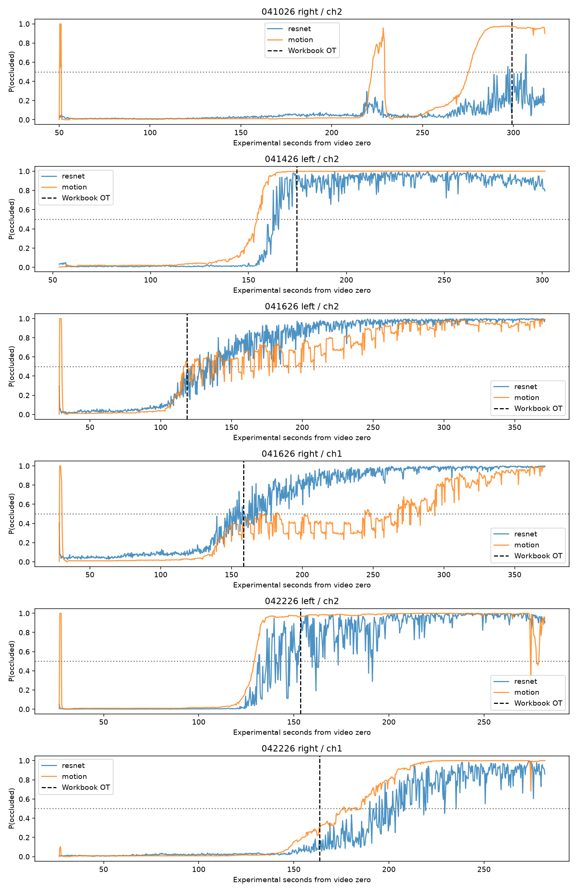

# Microfluidic occlusion detection

Detect blood-flow occlusion in microscopy videos and evaluate predictions against experimentally recorded occlusion times (OTs). This repository includes an ImageNet-pretrained ResNet18 baseline and a causal frame-difference motion baseline.

The current experiment uses **six approved channels from four control videos**, with **leave-one-video-out cross-validation**. Both channels from a recording always stay in the same split. These are small-sample **development results**, not external or clinical validation.

## Recorded comparison

Both methods use identical held-out videos and 5,142 eligible post-entry frames. Frame metrics are pooled; adjacent frames are correlated and are not independent experiments.

| Metric | ResNet18 | Motion + logistic regression |
|---|---:|---:|
| Recall / sensitivity | 90.1% | 83.1% |
| Precision | 96.4% | 89.6% |
| Specificity | 96.6% | 90.3% |
| F1 | 0.932 | 0.862 |
| Accuracy | 93.4% | 86.7% |
| Channels with a sustained trigger | 5/6 | 6/6 |
| Onset MAE, triggered channels only | 18.2 s (n=5) | 59.7 s (n=6) |
| Onset MAE on the same five triggered channels | 18.2 s | 56.2 s |
| Pre-OT sustained alarm episodes | 4 | 7 |
| First triggers more than 5 s early | 2/6 | 5/6 |

All timing errors are **experimental seconds**, not playback seconds. ResNet did not produce a sustained trigger for 041026 right; its MAE excludes that missed event. Producing a trigger is not equivalent to accurate event detection.

A sustained alarm is probability >0.5 for five consecutive frames. Its onset is backdated to the first frame; online confirmation arrives four frames later (1.33 experimental seconds at 30 fps and 10x playback). A false-alarm episode is a positive run of at least five frames whose confirmation occurs before workbook OT. Separate runs count separately. The 4 versus 7 episodes occurred over 14.26 experimental minutes of eligible pre-OT footage. All six channels eventually occlude; this is not a false-alarm estimate from independent never-occluded controls.

[Full machine-readable comparison](results/six_controls/comparison.json) · [Per-channel report](results/six_controls/REPORT.txt)



## Dataset and clock

The owner reviewed the recordings and approved this selection:

| Video | Approved channel(s) | Workbook OT (experimental s) | Excluded |
|---|---|---|---|
| 041026 Control.avi | right / ch2 | 299.203874 | left / ch1 |
| 041426 Control.avi | left / ch2 | 174.658505 | right / ch1 |
| 041626 Control.avi | left / ch2; right / ch1 | 118.475791; 158.642935 | — |
| 042226 Control.avi | left / ch2; right / ch1 | 153.567356; 163.598068 | — |

- Original videos are 30 fps, 694×510, with user-confirmed **10x playback**.
- Experimental time = `10 * video_time_s`, starting at **video zero**. Visible blood arrival gates frame eligibility but does **not** shift the OT clock.
- Labels are 0 before channel OT and 1 at/after OT. This assumes occlusion persists after OT; these are OT-derived labels, not independently annotated frame labels.
- All four originals are treated as **top-to-bottom** after direction review. An earlier incorrect flip of April 10 was removed. Vertical-flip augmentation is disabled; horizontal flips and brightness augmentation remain for ResNet.
- ROIs: left `[70, 0, 240, 510]`, right `[480, 0, 670, 510]`; crops resized to 224×224 and saved as quality-95 JPEGs.
- Entry frames (zero-based): 041026 right 150; 041426 left 160; 041626 both 85; 042226 both 80.
- April 10 filename/case ID conflicts with the workbook date; identity follows the filename/case ID and the discrepancy remains unresolved.
- Exclusions were owner-directed during anomaly review. Detailed anomaly diagnoses were not recorded. The results apply only to the approved subset; do not attribute gains over the earlier eight-channel experiment solely to model changes.

The exact settings are in [configs/six_controls.json](configs/six_controls.json). Raw videos, private workbooks, generated crops and trained weights are **not distributed in this Git repository**. Obtain authorized access to the four original AVIs to reproduce training. Saved probabilities, metrics, protocols, logs and input fingerprints are included. A fresh clone can reproduce the comparison plots without the raw videos.

## Splits and models

Each of four folds holds out one entire video and trains on the other three. Excluded channels never enter either split. Every ResNet fold starts with fresh ImageNet-pretrained weights, not the earlier occlusion checkpoint. Settings are fixed, not selected on the held-out video.

**ResNet18:** timm feature backbone plus dropout 0.2 and a two-class head; full fine-tuning, 12 epochs, AdamW (learning rate 0.0003, weight decay 0.0001), batch size 32, seed 0, class-weighted cross entropy. Training samples every tenth frame (3 fps), omitting ±5 experimental seconds around OT. Test metrics use all eligible frames at 30 fps, including that transition band.

**Motion baseline:** mean and 90th-percentile absolute grayscale differences at lags 1 and 3 frames in the crop interior, plus trailing 15-frame means and standard deviations (12 features). StandardScaler and class-balanced logistic regression (C=1, max_iter=2000, seed 0) are fitted only on the training videos, using the same training frame indices and transition exclusions. All temporal windows are past-only. These features measure image change, not calibrated physical velocity.

**Known motion limitation:** unavailable history at startup is encoded as zero change. This implementation can produce artificial occlusion probabilities near entry and contributed to very early triggers on April 16. The published baseline retains this behavior for faithful reproduction; it is not ready for deployment. Proper missing-history handling is future work, not a claimed result.

## Reproduce

Run from the repository root. Python 3.12 was used for the recorded experiment, on Apple MPS. Other devices/library versions may produce different neural-network results even with the same seed.

```bash
python3.12 -m venv .venv
source .venv/bin/activate
pip install -e .
python -m unittest discover -s tests -v
```

`requirements-experiment.lock.txt` records the original environment (`pip freeze`) for provenance; it is not a cross-platform lockfile. ImageNet weights are downloaded on first use. The run used the previously verified normalized frame cache; preparation below reconstructs that cache from the originals, subject to decoder-version differences.

### 1. Prepare approved frames

Put the four original AVIs under a directory of your choice. The command searches it recursively and rejects ambiguous filenames, unexpected frame counts, and decode failures. Use original AVIs, not the transcoded preview MP4s.

```bash
python -m clotting.experiments.prepare \
  --config configs/six_controls.json \
  --videos /path/to/control-videos \
  --out data/six_controls
```

Expected output: **5,142 crops**, `dataset.json`, `frame_labels.json`, and source hashes. Existing labeled output is not overwritten; choose a new directory to re-extract. Configured entry frames are manual review inputs, not an automatic blood-arrival detector.

### 2. Retrain both baselines

```bash
python -m clotting.experiments.train_resnet \
  --data data/six_controls --out runs/six_channel_comparison

python -m clotting.experiments.train_motion \
  --data data/six_controls --out runs/six_channel_comparison

python -m clotting.experiments.compare --out runs/six_channel_comparison
```

Each training command saves four models (one per held-out video), per-channel probability signals, protocols and summaries. The comparison verifies identical training counts, held-out video identities, test timestamps and labels. Checkpoints are local `.pt` files for ResNet and `.joblib` files for motion; load only trusted files.

To regenerate the **published** comparison without retraining or raw videos:

```bash
python -m clotting.experiments.compare --out results/six_controls
```

The archived results are a single run, not an average across seeds. Review per-video metrics: the strong pooled score hides the failure on April 10 right. Newly collected videos are needed for a final untouched test because these recordings and earlier results informed development and exclusions.

## Earlier single-video workflow

The original commands under `clotting.io.extract`, `clotting.train.classify` and `clotting.infer.predict` remain available, but implement a **different experiment**: one video, early/late temporal labels, leave-one-channel-out evaluation, and no workbook OT reference. They do not reproduce the six-channel results above. The old demo in `docs/` is historical and is not evidence for the new evaluation.

## License

Code is distributed under the [MIT License](LICENSE). This does not grant access to private source videos or workbooks.
